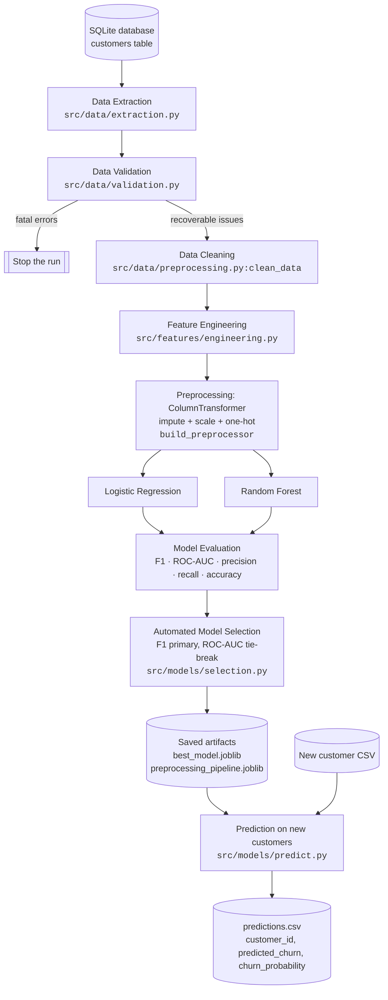

# Customer Churn Prediction Pipeline

> An end-to-end, production-style machine learning pipeline that predicts customer churn — from a **SQL database** all the way to **scored predictions on unseen customers** — with validation, cleaning, feature engineering, automated model selection, persisted artifacts, and a full test suite.

<p>
  
  
  
  
  
</p>

---

## Why this project

Customer churn is one of the highest-value classification problems in subscription businesses. This repository is a compact but realistic demonstration of how such a model is built in practice — not a notebook experiment, but a modular, reproducible pipeline with a strict **train/inference contract**: the *same* cleaning and feature-engineering code runs in both paths, and inference reuses the *already-fitted* preprocessing object rather than refitting a new one.

**What it demonstrates**

- Treating **SQL as the source of truth** with a reusable, injection-safe data-access layer.
- A validation layer that separates **fatal errors** from **recoverable data-quality issues**.
- Leakage-free feature engineering and a scikit-learn `ColumnTransformer` / `Pipeline`.
- Training and comparing **two models**, then selecting a winner from **actual computed metrics** (no hard-coding).
- Persisting artifacts with `joblib` so **new customers are scored without retraining**.
- Reproducibility via a fixed seed and centralized, environment-overridable configuration.
- A **26-test** `pytest` suite covering the database, validation, cleaning, feature engineering, preprocessing, training, evaluation, and prediction.

---

## Architecture



The training and inference paths share the same cleaning and feature-engineering functions, and inference loads the fitted preprocessor rather than fitting a new one:

```text
TRAINING:   Raw SQL  → clean → engineer → FIT preprocessor → train models → select → save
INFERENCE:  New rows → clean → engineer → APPLY saved preprocessor → saved model → predict
```

---

## Tech stack

| Area | Tools (all actually used in this repo) |
|------|----------------------------------------|
| Language | Python (3.10+) |
| Data | pandas, NumPy |
| Storage / SQL | SQLite (via Python's standard-library `sqlite3`) |
| ML | scikit-learn (`Pipeline`, `ColumnTransformer`, `LogisticRegression`, `RandomForestClassifier`) |
| Persistence | joblib |
| Visualization | Matplotlib, seaborn |
| Testing | pytest |
| Config | python-dotenv (`.env` overrides) |

No cloud services, containers, web frameworks, or external MLOps tools are used — the project runs entirely on a normal laptop.

---

## Results

Produced by actually running the pipeline with the default seed (`42`) and written to `reports/metrics/metrics.json`. Metrics are evaluated on a held-out, stratified test set of **1,200 rows**.

| Model | F1 | ROC-AUC | Accuracy | Precision | Recall |
|-------|---:|--------:|---------:|----------:|-------:|
| **Logistic Regression** _(selected)_ | **0.5751** | **0.7470** | 0.6700 | 0.4917 | 0.6925 |
| Random Forest | 0.5711 | 0.7446 | 0.6908 | 0.5167 | 0.6382 |

**Selected model: Logistic Regression.** Selection is automated: F1 is the primary metric, and models whose F1 is within `0.01` of the best are treated as tied and decided on ROC-AUC. Both models fell within tolerance, so the tie-break applied and Logistic Regression won on its higher ROC-AUC (0.7470 vs 0.7446).

> The moderate ROC-AUC (~0.75) is expected: the synthetic dataset is generated with a deliberately **noisy** feature→churn relationship so performance is realistic rather than artificially perfect. Running the pipeline regenerates these numbers and the figures in `reports/figures/` (per-model confusion matrices, overlaid ROC curves, and a model-comparison bar chart).

---

## Dataset

The dataset is **synthetic and reproducible** — no proprietary or external data is used. `src/data/generation.py` builds a configurable number of customers (default 6,000) from a fixed seed, deliberately injecting the data-quality problems the pipeline exists to handle:

- missing values (`tech_support`, `monthly_charges`),
- duplicate `customer_id` values,
- impossible ages and negative charges,
- `total_charges` stored as **text** with blank entries (mirroring the well-known Telco export),
- inconsistent category spellings/casing.

Attributes include demographics (`age`, `gender`, `senior_citizen`, `partner`, `dependents`), account details (`tenure_months`, `contract_type`, `payment_method`, `internet_service`, `tech_support`, `online_security`, `paperless_billing`), charges (`monthly_charges`, `total_charges`), and the target `churn`.

---

## How the pipeline works

**1. SQL layer** — Records live in a SQLite `customers` table (`database/schema.sql`). `total_charges` is typed as text and `customer_id` is intentionally **not** unique, so data quality is enforced in code rather than hidden by the schema. `src/database/loader.py` provides a context-managed connection, parameterized reads, bulk seeding via pandas, and a table-name allow-list guarding against SQL injection. The pipeline reads from SQL, never directly from a CSV.

**2. Validation** (`src/data/validation.py`) — Produces a structured report splitting **fatal errors** (missing required columns, empty data, an unusable target → the run stops) from **recoverable issues** (duplicates, missing values, out-of-range numbers → reported, then cleaned). Nothing is dropped silently.

**3. Cleaning** (`clean_data`) — Stateless: resolves duplicate IDs, coerces numeric columns (blanks → `NaN`), canonicalizes category spellings, sets out-of-range values to `NaN`, and encodes the target to 0/1. Learning no statistics means it is safe to reuse verbatim at inference.

**4. Feature engineering** (`src/features/engineering.py`) — Row-local and leakage-free: `avg_monthly_spend`, `charges_per_tenure`, `service_count`, and a categorical `tenure_group`. No feature uses the target or dataset-wide aggregates.

**5. Preprocessing** (`build_preprocessor`) — A `ColumnTransformer`: numeric features get median imputation + standard scaling; categorical features get most-frequent imputation + one-hot encoding (`handle_unknown='ignore'`). It is fitted **once** on the training split, saved, and reused unchanged at inference.

**6. Models** — **Logistic Regression** (`class_weight='balanced'`) and **Random Forest** (300 trees, depth-limited, `class_weight='balanced_subsample'`). The ~32% class imbalance is handled with class weighting plus a stratified split — a deliberately simple, well-understood choice rather than resampling techniques that aren't warranted at this skew.

**7. Evaluation & selection** — F1 and ROC-AUC (plus accuracy, precision, recall, confusion matrix) are computed on the test set; the winner is chosen by the documented rule in `src/models/selection.py`; metrics are written to JSON and figures to `reports/figures/`.

**8. Prediction** (`src/models/predict.py`) — Loads the saved preprocessor and model and scores a new batch through the identical cleaning/feature-engineering/preprocessing steps — **no retraining**.

---

## Project structure

```
customer-churn-prediction/
├── data/
│   ├── raw/                 # CSV reference copy of generated data (gitignored)
│   ├── processed/           # processed dataset + prediction outputs (gitignored)
│   └── sample/              # new_customers.csv for the prediction demo
├── database/
│   ├── schema.sql           # customers table definition
│   ├── seed.sql             # example INSERTs (full seed is programmatic)
│   └── churn.db             # SQLite database (generated, gitignored)
├── src/
│   ├── config.py            # central, env-overridable configuration
│   ├── database/loader.py   # reusable SQLite access layer
│   ├── data/
│   │   ├── generation.py    # synthetic dataset generator
│   │   ├── extraction.py    # SQL → DataFrame
│   │   ├── validation.py    # validation report (fatal vs recoverable)
│   │   └── preprocessing.py # clean_data + build_preprocessor
│   ├── features/engineering.py
│   ├── models/
│   │   ├── train.py         # split, fit preprocessor, train models
│   │   ├── evaluate.py      # metrics + figures
│   │   ├── selection.py     # automated model selection
│   │   └── predict.py       # load artifacts & score new data
│   └── pipeline.py          # end-to-end orchestration
├── models/                  # saved preprocessor + best model (generated, gitignored)
├── reports/
│   ├── figures/             # confusion matrices, ROC, comparison (generated)
│   └── metrics/metrics.json # machine-readable metrics (generated)
├── scripts/
│   ├── setup_database.py    # generate data + seed the database
│   ├── train.py             # run the training pipeline
│   └── predict.py           # score a new batch
├── tests/                   # pytest suite (26 tests)
├── requirements.txt
├── pyproject.toml
├── .env.example
└── .gitignore
```

Generated artifacts (the database, `.joblib` models, figures, raw/processed CSVs) are intentionally **not** committed — they are fully reproducible from the scripts below.

---

## Getting started

```bash
# Clone
git clone https://github.com/PratyakshDwivedi/Customer-Churn-Prediction.git
cd Customer-Churn-Prediction

# Create & activate a virtual environment
python -m venv .venv
# Windows:
.venv\Scripts\activate
# macOS/Linux:
source .venv/bin/activate

# Install dependencies
pip install -r requirements.txt
```

Python 3.10+ is required (built and verified on 3.11).

## Usage

```bash
# 1. Create and seed the SQLite database (also writes a prediction sample)
python scripts/setup_database.py

# 2. Train, evaluate, select the best model, and save artifacts
python -m src.pipeline
#    (equivalent: python scripts/train.py)

# 3. Score a new batch of customers — no retraining
python scripts/predict.py --input data/sample/new_customers.csv

# 4. Run the test suite
pytest
```

### Example prediction output

Actual output from scoring `data/sample/new_customers.csv` (`data/processed/predictions.csv`):

```
customer_id,predicted_churn,churn_probability
C000001,0,0.4851
C000002,1,0.5408
C000003,1,0.5362
C000004,1,0.6872
C000005,1,0.7906
C000006,0,0.1858
```

---

## Configuration & reproducibility

- `src/config.py` centralizes the random seed, test size, dataset size, database path, and artifact locations.
- All of these can be overridden through environment variables (optionally via a local `.env` — see `.env.example`), e.g. `RANDOM_SEED`, `TEST_SIZE`, `N_CUSTOMERS`, `DATABASE_PATH`, `LOG_LEVEL`.
- The fixed seed (default `42`) makes data generation, the train/test split, and the models deterministic.
- To run on **new data**, replace the rows in the `customers` table (or point `DATABASE_PATH` at another SQLite file with the same schema) and rerun `python -m src.pipeline`. Scoring a different batch only needs a new CSV passed to `scripts/predict.py` — no code changes.

---

## Testing

```bash
pytest
```

The suite (26 tests across `tests/`) covers: database connection and parameterized extraction, the SQL-injection guard, validation (fatal vs recoverable), cleaning behavior, feature engineering, the fitted preprocessing shape, training of both models, metric ranges, the model-selection rule and its tie-break, artifact creation, and prediction on unseen data (including that inference is deterministic and does not refit the preprocessor).

---

## Future improvements

These are **not implemented** — they are honest next steps, not existing features:

- Hyperparameter tuning (grid / Bayesian search).
- Cross-validation for more robust metric estimates.
- Additional models (e.g. gradient boosting) in the comparison.
- Experiment tracking and model/data versioning.
- Data-drift detection and production monitoring.
- A service/API layer for deployment.
